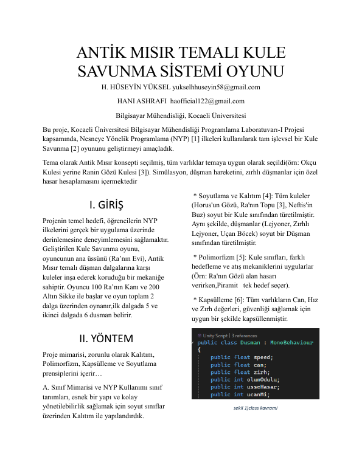
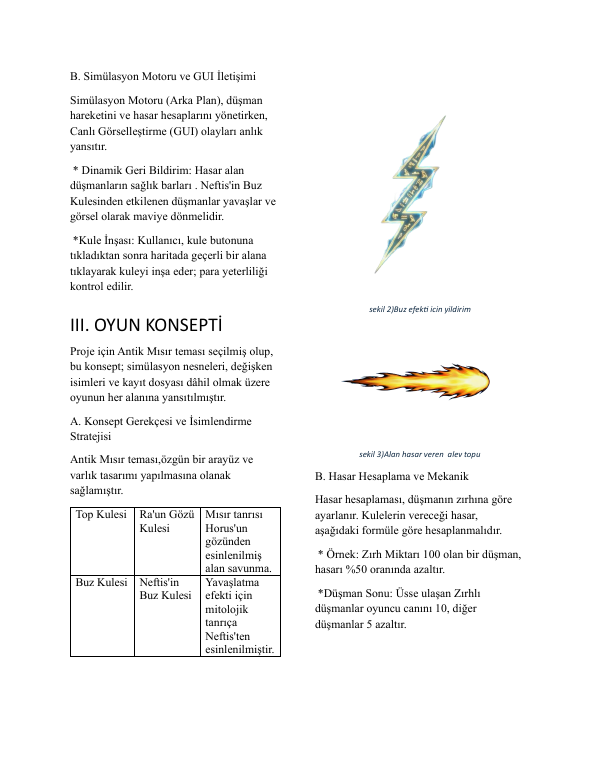
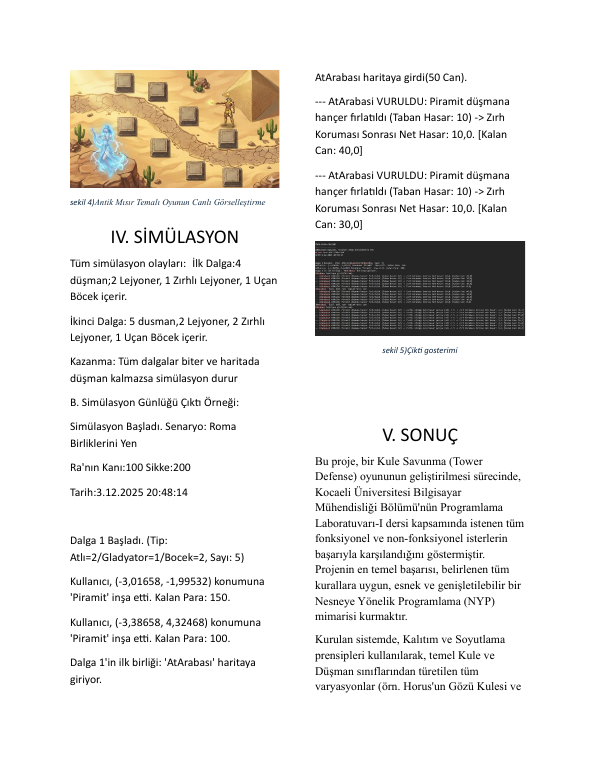
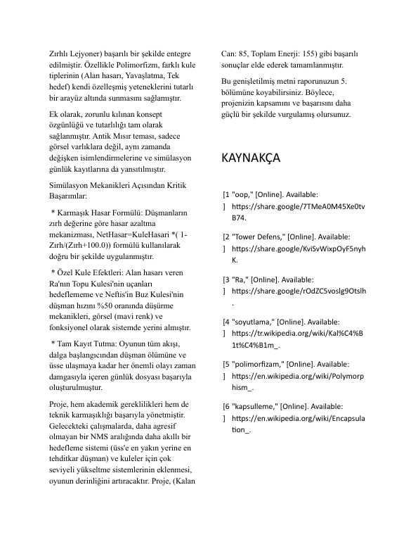

# Ancient Egypt tower defense (Unity, C#)

A 2D tower-defense game with an ancient-Egypt theme, built to show object-oriented programming principles.

## Context

Coursework for the Programming Laboratory (Prolab) course, Computer Engineering, Kocaeli University - Fall 2025, project 2.

## What it does

- Waves of enemies (chariots, gladiators, insects, armoured units) walk a path
- Towers (for example the pyramid and ice tower) shoot projectiles; armour reduces damage
- Gold and life resources, main menu, and an event log written during play
- OOP: an abstract `Dusman` base class, inheritance for each enemy, `virtual`/`override` damage and death, protected fields

## Build / run

Open the folder with Unity Hub (editor 6000.2.6f2 or newer; Hub offers to upgrade a newer one). The `Library` folder is not stored here, Unity rebuilds it on first open (a few minutes). Open `Assets/Scenes/AnaMenu.unity` and press Play.

Checked: every scene/prefab reference resolves to a file in the repo or a Unity package; the two scenes are in the build settings.

## Report

The full project report (PDF) is in `docs/report.pdf`.

## Notes

No API keys, tokens or credentials are used or stored in this repository.

## Report pages

Full report: [docs/report.pdf](docs/report.pdf)

